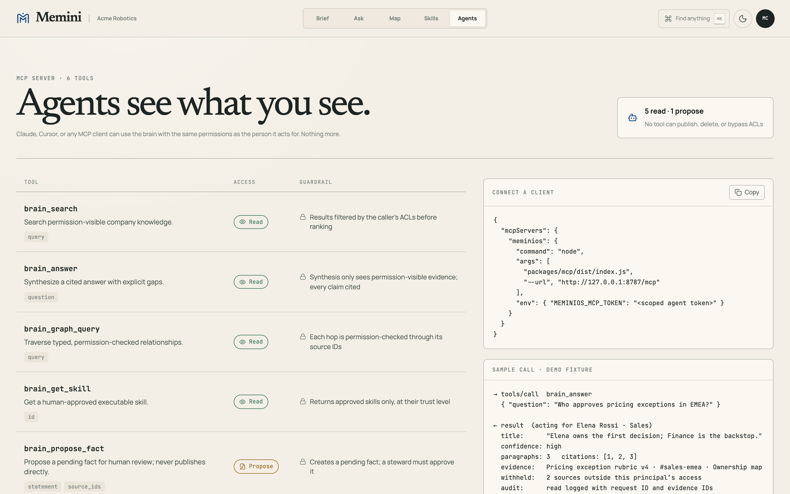
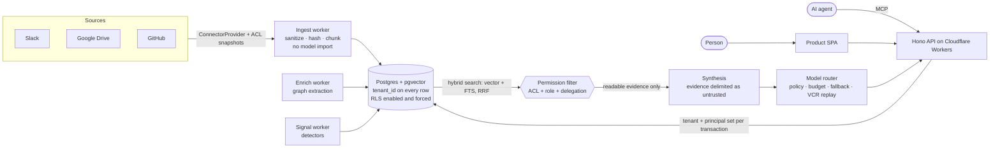

# MeminiOS

**A permissions-aware company brain: cited answers, proactive signals, and MCP tools that only see what the asking person is allowed to see.**


Company knowledge is spread across Slack, Drive, GitHub, and people's heads. MeminiOS ingests it into one tenant-isolated store. It answers questions with inline citations and says plainly what it doesn't know, and it raises proactive Signals: slipping commitments, stale policies, duplicate work. The same brain is exposed to AI agents over **MCP**.

Every read is permission-filtered **before** anything reaches synthesis. A person, or an agent acting for them, only gets answers built from documents that person can already open.

> Demo mode runs with no keys, database, or model: `pnpm install && pnpm demo` opens http://localhost:4108. See [Demo mode](#demo-mode).

## Features

- **Ask:** a document-style answer with numbered inline citations, an evidence rail, a confidence grade, an explicit "what the brain doesn't know" gap, and an expert-interview handoff.
- **Permission-aware retrieval you can see:** the demo's "Viewing as" switch shows the same question answered for Customer Success, Sales, and Finance. Each role gets a different answer, a different set of sources, and a count of what was excluded.
- **Brief:** a morning digest of cited Signals from three deterministic detectors (open commitments, stale knowledge, duplicate work), with feedback-based throttling.
- **Map:** a focused one-hop entity graph. Every edge carries source IDs, so each hop can be permission-checked.
- **Skills:** a governed library of company procedures with three trust levels (reference, draft-for-approval, autonomous), freshness decay, diffs, and steward approval.
- **Agents (MCP):** six tools for Claude, Cursor, or any MCP client, plus an `npx`-style stdio-to-HTTP bridge.



## Architecture



```text
apps/web            Vite + React product SPA (Brief, Ask, Map, Skills, Agents)
apps/api            Hono edge API: REST, OpenAPI, MCP JSON-RPC, realtime Durable Object
apps/*-worker       ingest, enrich, signal, and nightly "dream" stages
apps/landing        Next.js marketing site (no customer data)
packages/db         Drizzle schema, pgvector/FTS migration, forced RLS, seed, isolation tests
packages/retrieval  RRF hybrid ranking and ACL filtering (permissionFilter, canReadRecord)
packages/synthesis  injection-safe evidence assembly and gap-analysis contract
packages/model-router  OpenAI / Anthropic / Google adapters, call classes, budgets, fallback, replay
packages/extraction zero-LLM sanitization, graph extraction, chunking
packages/signals    detector framework and three deterministic detectors
packages/skills     approval and trust state machine, governed definitions
packages/connectors ConnectorProvider boundary, Slack and Drive adapters
packages/mcp        stdio-to-HTTP MCP bridge
packages/shared     Zod contracts, MCP tool definitions, seeded fixtures
packages/ui         design tokens and editorial components
```

## How retrieval, permissions, and MCP work

**Isolation in the database.** Every table carries `tenant_id`, and RLS is enabled _and forced_. The API sets tenant, principal, and role transaction-locally and runs as a non-superuser role. Source records are immutable to that role, and ACL refreshes are written as separate snapshots.

**Permission filtering in retrieval.** Hybrid search (pgvector + full-text, fused with reciprocal rank fusion) returns candidates. Then `permissionFilter` drops any record the principal can't read, before anything is assembled for the model. The check covers four things:

- tenant match
- minimum role
- group membership
- an explicit principal allow-list

When an agent acts for someone, the check uses the _delegated_ principal, so the agent inherits that person's access and nothing more. A Signal or skill is shown only if its **entire** evidence set is readable.

**Injection safety.** Ingested text is normalized and delimited as untrusted evidence. The synchronous ingest path cannot import the model router, and the prompt-injection corpus runs in the test suite.

**MCP tools** (`apps/api/src/mcp.ts`, definitions in `packages/shared/src/mcp-tools.ts`):

| Tool                 | Access  | Guardrail                                              |
| -------------------- | ------- | ------------------------------------------------------ |
| `brain_search`       | read    | results filtered by the caller's ACLs                  |
| `brain_answer`       | read    | synthesis sees only permission-visible evidence; cited |
| `brain_graph_query`  | read    | each hop permission-checked via source IDs             |
| `brain_get_skill`    | read    | approved skills only, at their trust level             |
| `brain_signals`      | read    | only signals whose full evidence set is readable       |
| `brain_propose_fact` | propose | creates a _pending_ fact; a steward must approve it    |

No tool can publish, delete, or change permissions. Search, answer, graph, and signal reads are written to the audit log with the request ID and the evidence IDs.

Connect a client:

```json
{
  "mcpServers": {
    "meminios": {
      "command": "node",
      "args": ["packages/mcp/dist/index.js", "--url", "http://127.0.0.1:8787/mcp"],
      "env": { "MEMINIOS_MCP_TOKEN": "<scoped agent token>" }
    }
  }
}
```

Build the bridge first with `pnpm --filter @meminios/mcp build`.

## Demo mode

```bash
corepack enable
pnpm install
pnpm demo          # http://localhost:4108
```

The product SPA falls back to deterministic fixtures when no API is running, so the demo needs no Docker, keys, or model calls. The data belongs to a fictional company, **Acme Robotics**: people, Slack threads, Drive docs, signals, skills, and a graph.

On **Ask**, the "Viewing as" switch runs the real `permissionFilter` from `@meminios/retrieval` over a small fixture corpus with per-document ACLs ([`apps/web/src/demo/permissioned-answer.ts`](apps/web/src/demo/permissioned-answer.ts)):

| Viewer                      | Readable sources | Answer                                                         |
| --------------------------- | ---------------- | -------------------------------------------------------------- |
| Maya Chen, Customer Success | 2 of 5           | 2 passages, medium confidence                                  |
| Elena Rossi, Sales VP       | 3 of 5           | 3 passages, including the Nordwell case from `#sales-emea`     |
| Daniel Okafor, CFO          | 4 of 5           | 4 passages, including the margin floor from a Finance-only doc |

The People Ops compensation doc matches the query but is readable by none of them, so it never appears.

## Running the full stack

Requires Node 24+, Docker, and Corepack.

```bash
pnpm install
cp .env.example .env
docker compose up -d        # pgvector Postgres
pnpm db:migrate && pnpm db:seed
pnpm dev                    # web :5173, API :8787, workers
```

## Tests

```bash
pnpm typecheck
pnpm test               # unit tests, 1,000-case randomized ACL fuzzer, prompt-injection corpus
pnpm test:integration   # disposable pgvector Postgres, real migration, non-superuser role,
                        # proves tenant and object-ACL isolation
pnpm build
pnpm format:check
```

CI runs all of the above, including the two-tenant RLS integration suite against a Postgres service container ([`.github/workflows/ci.yml`](.github/workflows/ci.yml)).

## Status: what's real

This is a seeded M0 product slice, not a deployed service.

- **Real and tested:**
  - the RLS migration and isolation suites
  - the permission filter and RRF ranking
  - deterministic extraction and the signal detectors
  - the skill trust state machine
  - the model router (in VCR replay mode, with no live calls by default)
  - the Hono API and MCP JSON-RPC handler, and the stdio bridge
- **Fixture-backed:**
  - The API's answer, graph, and MCP tool responses currently return the seeded Acme Robotics fixture, not live retrieval over ingested data.
  - Slack, Drive, WorkOS, and Composio sit behind typed adapters, but no credentials are configured.
- **Not done:** a hosted deployment. The Cloudflare and Vercel deploy workflow and Terraform shells exist but haven't been run.

Build history and remaining production work: [docs/PROGRESS.md](docs/PROGRESS.md). Dependency baseline: [VERSIONS.md](VERSIONS.md).

## Stack

TypeScript (strict), pnpm + Turborepo, Hono on Cloudflare Workers, Vite + React 19, TanStack Router and Query, React Flow, Postgres + pgvector + Drizzle, Zod, Vitest + fast-check, Next.js (marketing), GitHub Actions.
